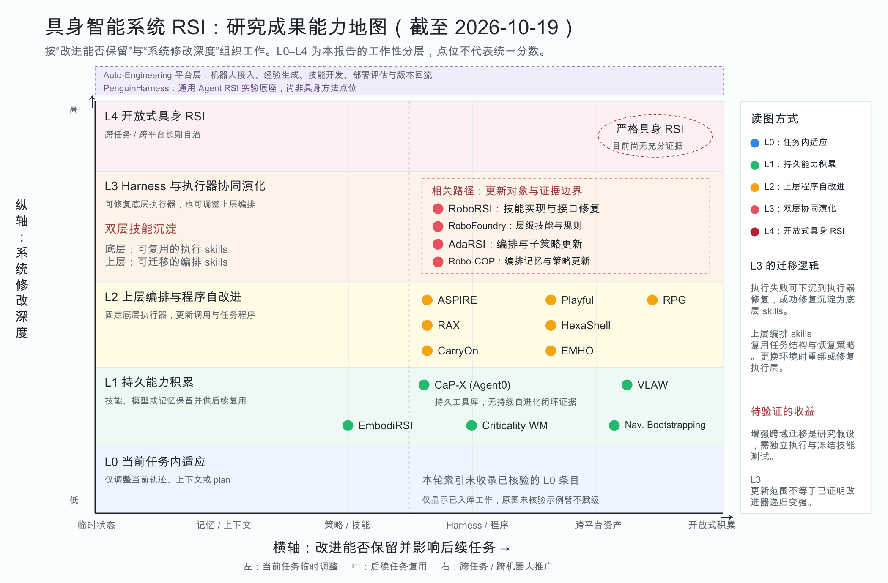

# Awesome RSI Harness

A curated list of papers on recursive self-improvement and self-evolving agents.

[Embodied RSI](#embodied-rsi) · [General Methods](#general-methods) · [Surveys](#surveys) · [Benchmarks](#benchmarks) · [Verification](#verification) · [Resources](#resources)

Embodied papers follow the capability map: L0 adaptation, L1 persistent capabilities, L2 program improvement, L3 orchestration and executor co-evolution, L4 open-ended embodied RSI. L3 lists related paths, not proof of recursive improvement of the improver.

<!-- BEGIN PAPER TABLES -->

## Embodied RSI

### L0 当前任务内适应

No curated entry yet.

### L1 持久能力积累

| Paper Title | Code |
| --- | --- |
| [CaP-X: A Framework for Benchmarking and Improving Coding Agents for Robot Manipulation](https://arxiv.org/abs/2603.22435) | - |
| [VLAW: Iterative Co-Improvement of Vision-Language-Action Policy and World Model](https://arxiv.org/abs/2602.12063) | - |
| [EmbodiRSI: Recursive Self-Improvement for Data-Efficient Robot Adaptation](https://arxiv.org/abs/2609.38905) | - |
| [Policy-Level Recursive Self-Improvement for Embodied AI with a Criticality World Model](https://arxiv.org/abs/2607.28251) | - |
| [Data-Centric Recursive Self-Improvement for Navigation via Policy-Synchronized Language-Action Dual Bootstrapping](https://arxiv.org/abs/2610.15782) | - |

### L2 上层编排与程序自改进

| Paper Title | Code |
| --- | --- |
| [ASPIRE: Agentic /Skills Discovery for Robotics](https://arxiv.org/abs/2607.00272) | [Code](https://github.com/NVlabs/ASPIRE) |
| [Playful Agentic Robot Learning](https://arxiv.org/abs/2606.19419) | - |
| [Reconstruct, Practice, Go Real: Guided Self-Improvement for Embodied Agents](https://arxiv.org/abs/2610.02204) | - |
| [Scaling Online Exploration for Robot Agents](https://arxiv.org/abs/2610.22496) | [Code](https://github.com/robot-agent-exploration/rax) |
| [HexaShell: A Thin Harness for Exploring the Limits of VLM Agents as Robot Coding Agents](https://arxiv.org/abs/2610.23479) | [Code](https://github.com/HexaFuture/HexaShell) |
| [CarryOn: A Dual-Loop Harness for Personalized and Reliable Robot Assistance](https://arxiv.org/abs/2610.21453) | - |
| [EMHO: EMbodied Agent Harness Optimization via Experience Traces](https://arxiv.org/abs/2610.08432) | - |

### L3 Harness 与执行器协同演化

| Paper Title | Code |
| --- | --- |
| [RoboRSI: Stable, efficient, and reusable robot self-evolution in complex real-world environments](https://arxiv.org/abs/2610.12424) | [Code](https://github.com/nssmd/RoboRSI) |
| [RoboFoundry: System-as-Policy Evolution for Self-Learning Embodied Agents](https://arxiv.org/abs/2609.32862) | - |
| [AdaRSI: On-Demand Recursive Self-Improvement for Embodied Agents](https://arxiv.org/abs/2610.20474) | - |
| [Co-Evolving Robot Orchestrators and Policies through Deployment](https://arxiv.org/abs/2610.09228) | - |

### L4 开放式具身 RSI

No entry with sufficient evidence yet.

## Surveys

| Paper Title | Code |
| --- | --- |
| [From Existing Methods to New Research Ideas: Two Perspectives on Recursive Self-Improvement](https://arxiv.org/abs/2610.14625) | - |
| [The Last AI Built by Humans: Toward Genuine Recursive Self-Improvement](https://arxiv.org/abs/2609.11873) | - |
| [The Path to Recursive Self-Improving Agents: Foundation, Framework, and Future Directions](https://www.preprints.org/manuscript/202608.0051/v1) | - |
| [Self-Evolving Agent Harness](https://arxiv.org/abs/2610.18813) | - |

## General Methods

### Model

| Paper Title | Code |
| --- | --- |
| [Terminal-RSI: Recursive Self-Improving Terminal Agents via Recursive Self-Rewrite and Policy-Refine](https://arxiv.org/abs/2610.22192) | - |
| [ReTerm: Recovery Training for Self-Improving Terminal Agents](https://arxiv.org/abs/2610.18484) | [Code](https://github.com/twothsnd/ReTerm) |
| [RSIPO: Recursive Self-Improving Policy Optimization for Agentic Reinforcement Learning via Skill-Policy Co-Evolution](https://arxiv.org/abs/2610.15772) | - |
| [MLExpert: Towards a Generalist Agentic Model for Autonomous Machine Learning Engineering](https://arxiv.org/abs/2610.22344) | - |
| [AgentSafeEvo: Adversarial Co-Evolution for LLM Agent Safety](https://arxiv.org/abs/2610.19422) | - |
| [Self-Adapting Language Models](https://arxiv.org/abs/2506.10943) | [Code](https://github.com/mithilai/SEAL) |

### Memory and Skills

| Paper Title | Code |
| --- | --- |
| [Recurrent Harness for Agentic Continual Learning](https://arxiv.org/abs/2610.12668) | - |
| [Cortex: Measurement-Gated Evolution and Pruning of Coding-Agent Skills and Rules](https://arxiv.org/abs/2610.14216) | - |
| [VIEWCRAFT: Evolving What Multimodal Agents See and How They Read It](https://arxiv.org/abs/2610.15915) | - |
| [SwarmRSI: Recursive Self-Improvement through Evolving Scientific Agent Swarm](https://arxiv.org/abs/2610.20431) | - |

### Harness

| Paper Title | Code |
| --- | --- |
| [Harness^2: Recursive Agent Harnessing for an Open World](https://arxiv.org/abs/2610.14224) | [Code](https://github.com/google-research/harness2) |
| [Video-RSI: Recursive Self-Improvement of Video Understanding Agents via Harness Evolution](https://arxiv.org/abs/2609.37950) | [Code](https://github.com/bingjunluo/Video-RSI) |
| [Self-Taught Optimizer (STOP): Recursively Self-Improving Code Generation](https://arxiv.org/abs/2310.02304) | [Code](https://github.com/microsoft/stop) |
| [Darwin Godel Machine: Open-Ended Evolution of Self-Improving Agents](https://arxiv.org/abs/2505.22954) | [Code](https://github.com/jennyzzt/dgm) |
| [GEPA: Reflective Prompt Evolution Can Outperform Reinforcement Learning](https://arxiv.org/abs/2507.19457) | [Code](https://github.com/gepa-ai/gepa) |

### Data and Environments

| Paper Title | Code |
| --- | --- |
| [AutoSFT: An Agentic System for Automated Data Research in Supervised Fine-Tuning](https://arxiv.org/abs/2610.22194) | - |
| [ClawLoop: Self-Improving Agents via Harness-Native Training Loop](https://arxiv.org/abs/2610.14118) | - |
| [WorkRover: Scaling Long-Horizon Cowork Agent Training Via Recursive Environment Evolution](https://arxiv.org/abs/2610.18067) | - |
| [CoDA: Co-Evolution of Data Engines and Action Policies](https://arxiv.org/abs/2610.22362) | - |

## Benchmarks

| Paper Title | Code |
| --- | --- |
| [GDPevo: Evaluating Agent Self-Evolution on Real Business Tasks](https://arxiv.org/abs/2608.03764) | [Code](https://github.com/Prism-Shadow/GDPevo) |
| [Rethinking the Evaluation of Harness Evolution for Agents](https://arxiv.org/abs/2607.12227) | - |
| [Doc2Harness: Benchmarking LLMs on Long-Horizon Harness Engineering of Coding Agents](https://arxiv.org/abs/2610.20344) | - |
| [EmbodiedCLBench: Evaluating Continual Learning for Self-Evolving Embodied Agents](https://arxiv.org/abs/2610.13021) | - |
| [RSIGym: A Flexible Environment for Recursive Self-Improvement](https://arxiv.org/abs/2610.10310) | - |
| [SWE-Duel: Towards a Self-Scaling Arena for Coding Agents](https://arxiv.org/abs/2610.12569) | - |

## Verification

| Paper Title | Code |
| --- | --- |
| [Scalable Weak-to-Strong Verifier Hardening for Agent Environments](https://arxiv.org/abs/2610.15924) | - |
| [CLIFT: Conformal Self-Verification for Web Agent Training and Test-Time Scaling](https://arxiv.org/abs/2610.06829) | - |
| [Can an Agent Learn to Predict Its Own Failure? Outcome-Grounded Confidence Calibration in LLM Agents](https://arxiv.org/abs/2610.18614) | - |

<!-- END PAPER TABLES -->

## Resources

- [PenguinHarness](https://github.com/Prism-Shadow/penguin-harness)
- [Prism-Shadow Awesome RSI](https://github.com/Prism-Shadow/awesome-rsi)
- [The Path to Recursive Self-Improving Agents](https://github.com/D2I-ai/awesome-recursive-self-improving-agents)
- [The Last AI Built by Humans](https://github.com/theseus-labs-rsi/awesome-rsi)
- [LobeHub Awesome RSI](https://github.com/lobehub/awesome-rsi)
- [Harness RSI](https://github.com/zgcagi/Harness-RSI)
- [Awesome Agentic Robots](https://github.com/chonghanqin/Awesome-Agentic-Robots)
- [ICLR 2026 RSI Workshop](https://recursive-workshop.github.io/papers.html)

## Notes

Embodied methods follow this collection's L0–L4 map; general methods retain their update-target groups. CaP-X is positioned using its CaP-Agent0 branch. Benchmarks and verification are separate. Inclusion does not imply demonstrated improvement of the improvement mechanism itself. `-` in Code means no implementation link was verified for this index.

Updated: 2026-10-19. [Metadata](data/papers.json) · [CSV](data/papers.csv) · [RIS](data/papers.ris) · [Content audit](docs/CONTENT_SYSTEM_ZH.md) · [Evidence matrix](docs/PAPER_MATRIX_ZH.md) · [Reading guide](docs/READING_GUIDE_ZH.md) · [Survey comparison](docs/RELATED_SURVEYS_ZH.md) · [Screening notes](docs/SCREENING.md)

## Contributing

See [CONTRIBUTING.md](CONTRIBUTING.md). Suggestions are welcome through [issues](https://github.com/zz2ethankai/awesome-rsi-harness/issues).

## Acknowledgments

The paper-table format follows Awesome Agentic Robots; the update-target organization draws on the RSI surveys and collections linked above. Annotations are independently prepared. Linked materials retain their original licenses; a license for this collection has not yet been selected.

## Roadmap

[PowerPoint](assets/RSI_Capability_Map.pptx) · [Classification](data/capability-map.json)
